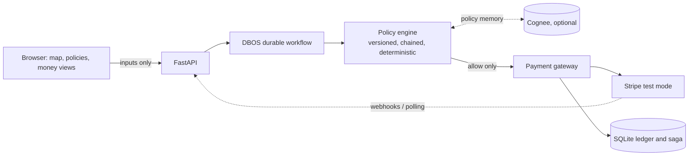

# Agent Treasury

**Chain written policies. Pay by situation. Explain every payment.**

Attach versioned, chained policies to a payment and feed them changing inputs (amount, coverage, location, receipt, cancellation). A deterministic engine returns `allow`, `hold` or `deny`, and only an `allow` can reach a Stripe test-mode payment, with the clause-level evidence that explains why.

Built for the Briefcase x Stripe hackathon (October 2026). Stripe test mode only; live keys are rejected in code. Independent project: not affiliated with or endorsed by Stripe or Briefcase.

[](LICENSE)

> Demo video: **TODO** (add link, 2 minutes or less). Screenshots are intentionally omitted until the live UI is wired to the backend.

## Why

Agents that move money need rules that are written down, versioned and enforced outside the model. A payment is rarely governed by one rule: an organisation has base rules, each job adds its own (coverage, fuel cap) and the situation keeps changing. This project makes the chain the first-class object. The same inputs always give the same decision, a permissive policy can never override a restrictive one, and a model or a map marker never gets financial authority.

## Chained policies, paid by situation

Every payment's effective policy is the union of the mandatory organisation policy plus whatever is attached to the payment or inherited from its job. Verdicts combine restrictively: **deny beats hold beats allow**.

Illustrative chain (the `org-base` clauses are the real seeded policy in `src/treasury/policy.py`; `job-cover` and `fuel-cap` are example policies published through the same engine). The outputs below were produced by running the registry in `src/treasury/policies.py`.

```
 org-base v1 (mandatory)   PAY-1      receipt_confirmed required        -> hold if missing
                           TRAVEL-1   prohibited_zone forbidden         -> DENY if present
                           APPROVE-1  amount <= USD 50.00               -> hold if above
 job-cover v1 (job)        COVER-1    coverage_valid required           -> hold if missing
 fuel-cap  v1 (job)        FUEL-1     amount <= USD 8.00                -> hold if above
```

| Step | Input change | Result | Why |
|---|---|---|---|
| 1 | coverage valid, no receipt, USD 5.00 | **hold** | `org-base` PAY-1: receipt missing |
| 2 | receipt confirmed | **allow** | all clauses pass; payment is released |
| 3 | route enters a prohibited zone | **deny** | `org-base` TRAVEL-1; cover and receipt cannot override it |
| 4 | USD 90.00 request | **hold** | APPROVE-1 and FUEL-1 both fail; needs approval |
| 5 | coverage record lapses | **hold** | `job-cover` COVER-1: coverage missing |

Rules enforced in code and covered by `tests/test_policies.py`:

- A permissive attached policy cannot lift the USD 50 approval threshold or bypass a denial; a stricter one tightens the result.
- Organisation policy is mandatory: it cannot be detached, downgraded or weakened by a replacement version (HTTP 403).
- If an attached mandatory policy is stale (a newer version exists), unknown or its content hash does not match, the decision is `hold`, not `allow`.
- Attach/detach use expected-version checks (HTTP 409 on conflict) and a target that is no longer pending is locked.
- Decisions are immutable records; replaying the same inputs and attachments returns the same record.

Other clause IDs from the scenarios, with the code that evaluates them: DRIVER-1, COVER-1 and TRAVEL-1 (planner, `planner.py`), FUEL-1/FUEL-2 (`fuel.py`), RECEIPT-1 and PAY-1 gates (`proof.py`), REFUND-1 and MONEY-1 (`refunds.py`). The policy engine supports three clause kinds today: `max_amount`, `require_input`, `forbid_input`. Richer geofence and coverage evaluation lives in the planner, fuel and proof modules rather than in the generic engine.

## Four scenarios

All map positions, insurance records and receipts are simulated inputs. Stripe operations are real test-mode API calls when a sandbox key is configured; otherwise a mock gateway is used and labelled as such.

| # | Scenario | Policy outcome | Money |
|---|---|---|---|
| 1 | Deliver and release | Early receipt outside the 100 m radius is rejected; fresh position plus a one-use receipt nonce passes (`proof.py`) | Two independent transfers: USD 70 merchant, USD 20 driver (USD 10 gross retention) |
| 2 | Fuel entitlement | Capture within the USD 8 cap at an allowed category and route corridor; over-cap or wrong category declined (`fuel.py`) | Issuing authorization/capture (needs Issuing access) |
| 3 | Coverage or route change | Coverage or route change fails COVER-1/TRAVEL-1 and the planner replans pending work; it never relaxes policy (`planner.py`) | Completed operations are preserved; only pending work changes |
| 4 | Cancel and refund | REFUND-1 allows one full refund before pickup if no recipient transfers ran (`refunds.py`) | Refund of the original test payment, capped by remaining refundable amount |

An invoice chain is also implemented: an obligation above the threshold creates one Stripe test invoice and waits for actual payment (an open or hosted-link invoice never counts as funded) before later gates can pass (`invoices.py`).

## How a decision is explained

Each decision record carries:

- **Policy versions and hashes**: every attachment as (attachment id, policy id, version, mandatory) plus an effective-policy hash over the content hashes of all policies used.
- **Input revision**: the exact revision of inputs evaluated.
- **Clause results**: per policy and clause, an `allow`/`hold`/`deny` outcome with evidence (for example `{"missing": "receipt_confirmed"}` or `{"amount_minor": 9000, "limit_minor": 800}`).
- **Reasons**: stale, unknown or tampered policy, or no effective policy.
- **Provider references**: Stripe object IDs and `livemode=false` on payment, transfer, refund and invoice results from the gateway.

The AI sidebar (`chat.py`) is explanatory only. It cites retrieved decisions, drafts editable local messages and has no payment authority. It needs `ANTHROPIC_API_KEY`; without it the service reports itself unavailable.

## Architecture



- The browser sends inputs and shows decisions; it never supplies authority.
- DBOS workflows (`workflows.py`) wait for input events, evaluate policy and pay through an idempotent saga store with stable operation IDs (`saga.py`).
- Cognee is behind an interface (`memory.py`). If it is not installed or configured, policy publishing reports `unavailable` instead of pretending a write happened. The canonical policy snapshot stays local and hash-checked.
- The gateway (`stripe_gateway.py`) rejects live keys and any object with `livemode=true`, and reports unavailable capabilities with setup guidance.

## Quickstart

Requires [uv](https://docs.astral.sh/uv/), Node.js and, optionally, the [Stripe CLI](https://docs.stripe.com/stripe-cli).

```bash
git clone https://github.com/OWNER/agent-treasury.git   # replace OWNER once the repo is published
cd agent-treasury

# Backend
uv sync
uv run pytest -q                      # runs offline; live Stripe test skips without a key

# Stripe sandbox (optional; without it the mock gateway is used)
stripe sandbox create                 # provisions a claimable sandbox and prints a test key
cp .env.example .env                  # then set STRIPE_SECRET_KEY=sk_test_... (never commit .env)
uv run --env-file .env python -m treasury.probe   # reports payments / USD Connect / Issuing / invoicing

# API server
uv run --env-file .env uvicorn treasury.api:create_app --factory --port 8000

# Frontend
cd frontend
npm install
npm run dev                           # VITE_API_MODE=fixture npm run dev for canned data
npm test && npm run build
```

Notes:

- The code reads `STRIPE_SECRET_KEY` from the environment only; `uv run --env-file .env` loads it.
- `stripe sandbox create` is the Stripe CLI command for provisioning a sandbox; check `stripe sandbox --help` for your CLI version.
- `ANTHROPIC_API_KEY` enables the AI sidebar; `STRIPE_WEBHOOK_SECRET` (from `stripe listen`) enables invoice and fuel webhooks, with a manual poll route as fallback.

## What is real vs simulated

| Part | Status |
|---|---|
| Policy engine, versioning, hashes, attachments, chaining, deny > hold > allow | Real, tested |
| Decision records and clause evidence | Real, tested |
| DBOS durable workflow, idempotent saga, restart recovery | Real, tested against SQLite and a mock gateway |
| Stripe PaymentIntent, refund, transfer, invoice, Issuing calls | Real test-mode API code; unit-tested with fakes; live path needs a sandbox key |
| Stripe Issuing and Connect transfers | Blocked on the current sandbox key (limited `rkcs_test_`); unverified until `treasury.probe` reports them |
| Map positions, routes, zones | Simulated |
| Insurance/coverage records | Simulated demo records; no insurer integration |
| Recipient receipt confirmation | Simulated one-use nonce; not production authentication |
| Fuel merchant | Simulated test merchant; no real fuel sold |
| Cognee policy memory | Optional; interface and graceful fallback implemented, not exercised by tests against a live Cognee |
| AI explanations and drafts | Real model call when `ANTHROPIC_API_KEY` is set; no authority; no external messaging |

## Status and roadmap

Verified 15 October 2026 (integration pass):

- `uv run pytest -q`: 278 passed, 2 skipped (live Stripe and live Cognee tests, which need credentials).
- `npm test` in `frontend/`: 85 passed; `npm run build` succeeds.
- `uv run python scripts/run_demo.py --mock` runs all four scenarios over HTTP on a fresh database and the audit hash chain verifies. Without `--mock` it uses whatever `.env` provides (see below).

What ran on real Stripe (test mode, limited `rkcs_test_` sandbox key): PaymentIntents, charges and a refund, plus the probe and the platform-funding step of `scripts/bootstrap_sandbox.py`. Real object ids were produced (visible in `/api/audit` and in the `run_demo.py` output).

What has NOT run on real Stripe, and why:

- **Connect transfers (merchant and driver legs), Issuing cards, Issuing top-ups**: blocked by the key type. The sandbox key is a claimable `rkcs_test_` key with limited permissions. Put a standard `sk_test_` key in `.env`, enable Issuing in the dashboard, then run `uv run python scripts/bootstrap_sandbox.py` and `uv run python -m treasury.probe`. Until then `deliver_and_release` and `fuel_entitlement` return an explicit `unavailable` result in `stripe_test` mode and move no money. Their full flow is only exercised on the mock gateway.
- Unverified against real Stripe (tested with fakes only): Custom-account test data, Issuing `user_terms_acceptance`, the cardholder billing address, `test_helpers.authorizations.reverse`.
- **Refund after transfers** (Stripe transfer reversals) is not built; refunds are capped to the amount not yet transferred and by a published recovery policy.
- **Job journey** (New job view): backend and UI tested against fixtures and TestClient; a dispatched job stays on hold until receipt and insurance evidence arrive through the mission routes. The frontend watch step was not exercised in a browser.
- **Webhooks**: `STRIPE_WEBHOOK_SECRET` is documented but no live webhook delivery was verified.

Other honest gaps:

- **Cognee**: wired and audited, never run against a real Cognee. Without `COGNEE_SERVICE_URL`+`COGNEE_API_KEY` (cloud) or `LLM_API_KEY` (local) explanations come from the audit log and say `source: audit_log`.
- **Agent LLM**: no live Anthropic call was made. Without `ANTHROPIC_API_KEY` the agent is GOAP-only and labels itself so. Two PAY-1 waivers (fuel allowance, refund) are explicit in `agent.py` and recorded in the audit log.
- **Authentication**: none. Approver identity (`X-Actor-Role`) and audit party scoping (`X-Party-Role`, `X-Party-Id`) are asserted headers for the demo only.
- **Inputs are simulated**: map positions, zones, coverage and the recipient device (the server plays the recipient unless a nonce flow is used).
- Scenario run state is in memory (money stays idempotent through operation ids).
- Policy-writing page and AI policy drafter (stretch) are not built.
- Demo video is not recorded.

## Hackathon requirements

- [x] Stripe test mode only (live keys rejected in `stripe_gateway.py`, tested)
- [x] Written spending policy in the repo (`src/treasury/policy.py`, `docs/POLICY_MODEL.md`, `docs/DELIVERY_DEMO.md`)
- [x] Evidence-based explanation per decision (clause results, versions, hashes)
- [ ] Public GitHub repository (owner step: see `docs/REPO_SETUP.md`)
- [ ] Demo video, 2 minutes or less (TODO)
- [ ] End-to-end live Stripe test run recorded with object IDs

Brief: <https://hackathons.briefcase.so/stripe-october-2026/>

## Documentation

[Delivery demo](docs/DELIVERY_DEMO.md), [policy model](docs/POLICY_MODEL.md), [scenarios](docs/SCENARIOS.md), [architecture](docs/ARCHITECTURE.md), [API routes research](docs/API_ROUTES.md), [API contract (planned)](docs/API_CONTRACT.md), [build plan](docs/PLAN.md), [repo setup](docs/REPO_SETUP.md).

## License

[MIT](LICENSE). Dependencies keep their own licences.
