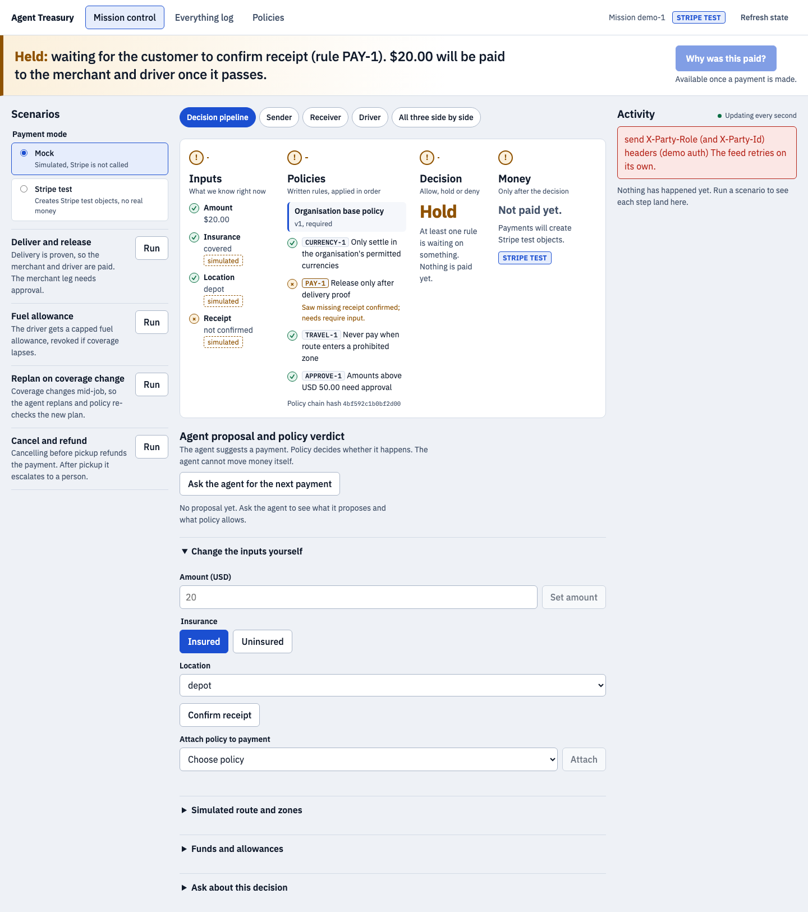
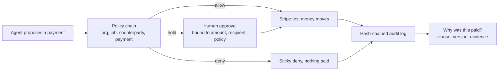
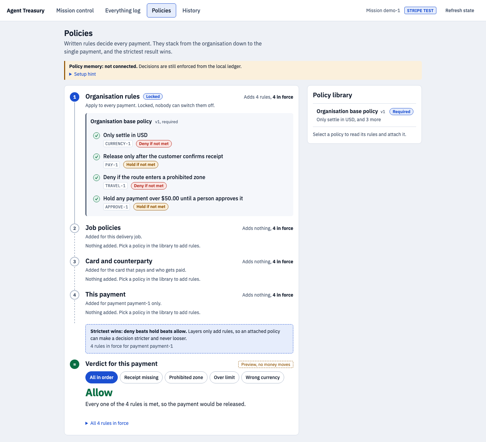
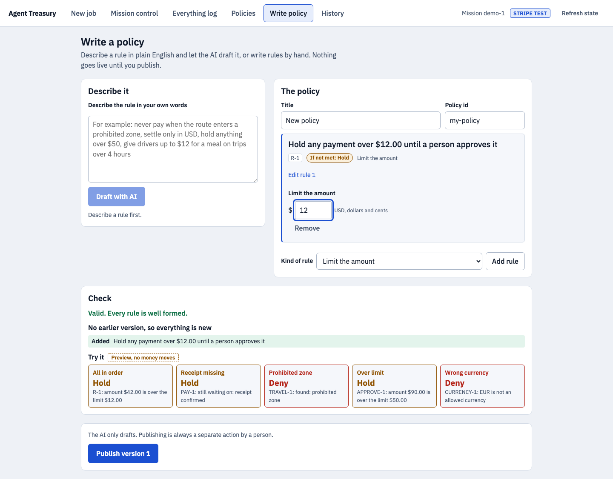
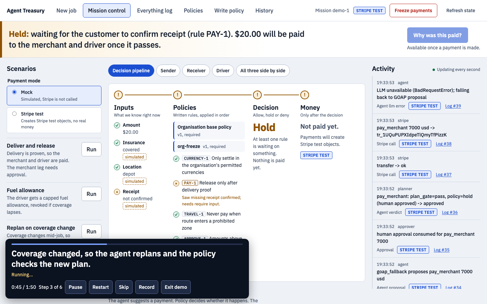
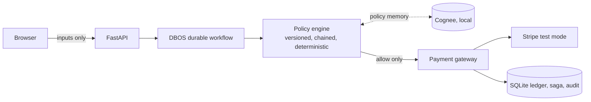

# Agent Treasury

**Agents propose. Written policy decides. Stripe test money moves. Every dollar is explained.**

Built for Briefcase x Stripe, Track 01 (agents that spend). Stripe test mode only; live keys are rejected in code. Independent project: not affiliated with or endorsed by Stripe or Briefcase.

[](LICENSE)



## What it is

Agents that move money need rules that are written down, versioned and enforced outside the model. Agent Treasury makes a chain of written policies the first-class object:

1. An organisation policy is mandatory and locked. Job, card/counterparty and per-payment policies stack on top.
2. An agent (Claude when `ANTHROPIC_API_KEY` is set, otherwise a deterministic planner) proposes a payment. It has no authority to execute it.
3. A deterministic policy engine returns `allow`, `hold` or `deny`. Strictest wins: deny beats hold beats allow.
4. Only an `allow` (or a human-approved hold) reaches Stripe test mode.
5. Every decision records the clause, the policy version and hash, and the evidence, so "why was this paid?" has a precise answer.

## The loop



## Screen grabs

**Policies: the rule stack.** Organisation rules are locked; layers only add rules, so an attached policy can tighten a decision and never loosen it. The verdict preview shows what each situation would do, with no money moving.



**Write a policy.** Describe a rule in plain English and let the AI draft it, or write it by hand. The check panel shows the diff against the previous version and tries the rule against five situations before anything is published. The AI only drafts; publishing is always a separate human action.



**Demo mode.** A guided, timed run drives the scenarios while narrating each step. This frame is mid-run (step 3 of 6): coverage changed, the agent replans, an extra `org-freeze` policy is in the stack, and the activity feed shows the approval, the planner verdict and a Stripe call. In this capture the Claude call was unavailable, so the feed honestly shows "LLM unavailable; falling back to GOAP proposal".



## What is REAL vs MOCK

| Part | Status |
|---|---|
| Stripe PaymentIntents, refunds, invoices | Real test-mode calls, verified against a sandbox |
| Stripe Connect transfers (merchant and driver legs) | Real test-mode transfers via Accounts v2, verified |
| Stripe Issuing fuel card | Unavailable until a v2 financial account is open. Falls back to a labelled mock or an explicit `unavailable` result; no money moves |
| Cognee policy memory | Runs locally. Stores policy versions and answers "which clause" questions with `source: cognee`; falls back to the audit log (`source: audit_log`) if absent |
| LLM agent and AI policy drafter | Claude via `ANTHROPIC_API_KEY`; without it the agent is a deterministic planner and says so |
| Policy engine, chaining, decisions, audit chain, saga, DBOS workflow | Real, tested |
| Map positions, routes, zones, insurance records, receipt confirmation, fuel merchant | Simulated inputs, labelled "simulated" in the UI |
| Authentication | None. Approver and party identity are asserted headers for the demo only |

The `Payment mode` switch in Mission control chooses between the mock gateway (Stripe is not called) and Stripe test mode.

## Features

- **Chained, tighten-only policies**: organisation, job, card/counterparty and payment layers; deny beats hold beats allow; an organisation policy cannot be detached or weakened.
- **CURRENCY-1 as a policy**: "only settle in permitted currencies" is a clause in the organisation policy, not hard-coded.
- **Counterparty, velocity and freeze clauses**: payee and merchant-category allow-list, max payments per trailing window, and a payment freeze that only an approver can lift (audit-logged).
- **Sticky deny**: once a payment is denied it stays denied.
- **Approvals bound to amount, recipient and policy**: an approval cannot be reused for a different payment.
- **Saga and durable DBOS execution**: idempotent operation ids, restart recovery.
- **Hash-chained audit log** with a verify route.
- **Bitemporal history**: ask "what was the policy then" and get the version that was in force at that time.
- **Audit pack download**: `GET /api/audit/pack?mission=<id>` returns a zip of report, audit log, decisions, policies and chain proof.
- **Policy writing page with AI drafter**, and **demo mode** (above).

Policy clause kinds: `max_amount`, `require_input`, `forbid_input`, `allowed_counterparties`, `velocity_limit`, `payment_freeze`. Scenarios: deliver and release, fuel allowance, replan on coverage change, cancel and refund.

## Quickstart

Requires [uv](https://docs.astral.sh/uv/) and Node.js.

```bash
git clone https://github.com/Ugbot/agent-treasury.git
cd agent-treasury
uv sync
cp .env.example .env        # never commit .env
make dev                    # API on :8000, web on :5173 (mock gateway by default)
```

Docker, if a `docker-compose.yml` is present in the checkout:

```bash
docker compose up
```

Real Stripe test mode:

```bash
stripe sandbox create                          # prints a test key
# set STRIPE_SECRET_KEY=sk_test_... in .env (live keys are rejected)
uv run --env-file .env python scripts/bootstrap_sandbox.py
uv run --env-file .env python -m treasury.probe   # reports payments / Connect / Issuing / invoicing
```

Optional: `ANTHROPIC_API_KEY` enables the Claude agent, explainer and policy drafter; `STRIPE_WEBHOOK_SECRET` (from `stripe listen`) enables webhooks. `make demo-run` drives all four scenarios over HTTP and verifies the audit chain.

## Architecture



The browser never supplies authority. The gateway rejects live keys and any `livemode=true` object. Design notes for contributors and agents: [CLAUDE.md](CLAUDE.md). More: [policy model](docs/POLICY_MODEL.md), [scenarios](docs/SCENARIOS.md), [architecture](docs/ARCHITECTURE.md).

## Tests

```bash
uv run pytest -q          # 331 passed, 2 skipped (live Stripe and live Cognee need credentials)
cd frontend && npm test   # 105 passed (17 files)
```

Numbers from a run on 15 October 2026.

## Hackathon checklist

- [x] Stripe test mode only (live keys rejected in `stripe_gateway.py`, tested)
- [x] Written spending policy in the repo (`src/treasury/policy.py`, `docs/POLICY_MODEL.md`)
- [x] Evidence-based explanation per decision
- [x] Public GitHub repository
- [x] Real Stripe test PaymentIntents, refunds, invoices and Connect transfers
- [ ] Demo video, 2 minutes or less (link to be added)

Brief: <https://hackathons.briefcase.so/stripe-october-2026/>

## Licence

[MIT](LICENSE). Dependencies keep their own licences.
