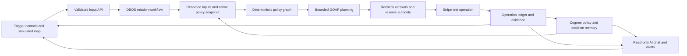

# Architecture: policy controls payments

## Boundaries

## Modules

| Module | Responsibility | Primary interface |
|---|---|---|
| treasury/models.py | Typed domain data, money, events, attachments and decisions | Pydantic models matching API_CONTRACT.md |
| treasury/policy.py + policy_graph.py | Resolve effective attachments; evaluate rules/obligations | evaluate(payment, inputs, snapshot) -> Decision |
| treasury/planner.py | Deterministic GOAP search over recorded facts | plan(world, goal, actions, max_expansions=1000) -> PlanResult |
| treasury/ledger.py | Persistent events, versions, reservations, operations, approvals and receipts | Atomic transactions with unique semantic operation IDs |
| treasury/workflows.py | Durable event loop, action dispatch and explicit saga branches | mission_workflow(mission_id), compensation_workflow(operation_id) |
| treasury/stripe_gateway.py | Typed test-only provider calls and reconciliation | collect, invoice, transfer, authorize_fuel, capture, refund, reconcile |
| treasury/memory.py | Cognee add/process/retrieve and readiness | publish_policy, recall_policy, remember_decision |
| treasury/chat.py | Grounded real-model explanations and local drafts | respond(job_context, bounded_history, request) -> ChatReply |
| treasury/api.py + app.py | Boundary validation, startup and serving | create_app(db_path, gateway), HTTP resources in API_CONTRACT.md |
| frontend/src/ | Input controls, map, graphs, evidence and chat | Shared contract; backend-authoritative state |

## Financial operation lifecycle

Use `planned -> reserved -> submitted -> confirmed`, with `held`, `denied`, `awaiting_approval`, `unknown`, `failed`, `compensating`, `compensated` and `compensation_required` branches. Invoice issue, payment authorisation, capture, transfer and refund have distinct operation kinds. Pending provider state is not confirmed receipt or available cash.

Before an external call, atomically persist the semantic operation ID, unchanged request hash, resolved attachments/effective-policy hash, input/assignment revisions and budget reservation. Recheck active policy and versions under the same reservation transaction. A unique operation identity prevents duplicate commands; a stable provider idempotency key protects retry. External Stripe I/O occurs outside the database transaction.

Unknown outcome means reconcile the existing operation. It does not permit a new operation to another destination. A new recipient or changed amount requires fresh authority and its own semantic operation. Persist confirmed effects across GOAP replans.

## DBOS execution and sagas

Use one stable workflow ID per mission and durable messages for unique input events. All nondeterministic reads, provider requests, time/random values and mutable-policy loading belong in checkpointed steps. GOAP is pure over the recorded snapshot, with stable tie-breaking. Do not use current unrecorded state to change replay order. [DBOS workflows](https://docs.dbos.dev/python/tutorials/workflow-tutorial)

DBOS step recovery cannot make Stripe and a local checkpoint atomic. A crash after Stripe accepts a request may repeat that step. Stable Stripe identities/reconciliation are mandatory. Use explicit workflow failure branches and idempotent compensation steps; the official SDK does not expose an automatic saga decorator. [DBOS steps](https://docs.dbos.dev/python/tutorials/step-tutorial), [official compensation example](https://docs.dbos.dev/python/examples/widget-store)

Compensation is operation-specific: revoke unused card authority; cancel a cancelable authorization; refund a collected charge if policy permits; reverse an eligible transfer if recovery conditions permit. Never automatically reverse a successful merchant transfer merely because a driver leg failed: default to completing/reconciling the remaining leg or escalating under a written recovery rule. Exhausted compensation remains visible and retryable.

Use DBOS datasource transaction steps for local budget/reservation mutations so application writes and their transaction-step results commit atomically. Keep the system/application DB files persistent and ignored. [DBOS transactions](https://docs.dbos.dev/python/tutorials/transaction-tutorial)

## Ledger records

Persist missions, input_events, policies, policy_versions, policy_attachments, decisions, approvals, operations, reservations, provider_events, messages and drafts. Minimum uniqueness: input event per mission/eventId; operation by mission/obligation/recipient/action; provider object by account/type/objectId; attachment by target/policy/version. Record state revisions and source references. Store amounts as integer minor units and currency on every monetary record; validate positive amounts and prohibit currency-mismatched arithmetic.

Use application transactional operations rather than an in-memory lock as the spending invariant. Serialize mission command handling and enforce database compare-and-swap/unique constraints for cross-request races. A second process must not defeat the budget reservation check.

## Trust and access

Local demo binds to loopback by default. Mutating operator/simulator endpoints use an ignored configured operator token or server session, exact origin checks and a bounded input schema; Stripe webhooks have their own signature validation. Clearly label simulator roles. No claim of real geolocation attestation, insurer verification or production MFA.

Customer/card data stays with Stripe. No secrets, PAN/CVC or actual user location enter Cognee, model prompts, frontend bundles or public logs. Demo people/positions are synthetic. Browser text rendering is escaped. Chat has no tools that spend, approve or activate policy; any proposal goes through the typed operator API and normal authorisation.

## Provider modes

`mock` and `stripe_test` are explicit payment modes and never mixed inside one mission. Mock IDs are prefixed `mock_`; Stripe test objects must assert `livemode=false`. Cognee/model connection status is independent of payment mode. Fixture UI data is labelled. Missing credentials are an actionable unavailability state, not permission to fake integration.
