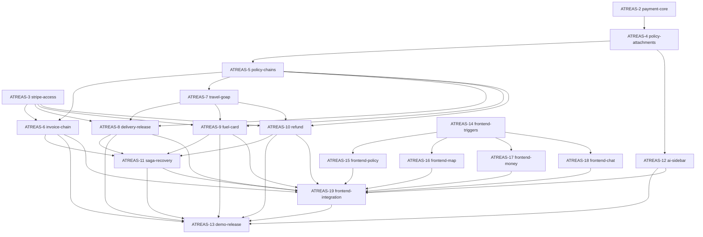

# Tracker backlog

Project **ATREAS**, epic **ATREAS-1**. Implementation is open; acceptance tests are planned, not run. Native dependency edges and criteria live in the tracker. Local Markdown mirrors each ticket.

## Backend

| Ticket | Deliverable | Blocked by |
|---|---|---|
| [ATREAS-2](tickets/ATREAS-2.md) | Backend: Drive a durable payment decision from changing inputs | None |
| [ATREAS-3](tickets/ATREAS-3.md) | Backend: Prove Stripe sandbox routes and expose capability readiness | None |
| [ATREAS-4](tickets/ATREAS-4.md) | Backend: Attach versioned Cognee policies to payments and entitlements | ATREAS-2 |
| [ATREAS-5](tickets/ATREAS-5.md) | Backend: Add and chain policies live without bypassing payment gates | ATREAS-4 |
| [ATREAS-6](tickets/ATREAS-6.md) | Backend: Invoice above a threshold and wait for actual payment | ATREAS-3, ATREAS-5 |
| [ATREAS-7](tickets/ATREAS-7.md) | Backend: Use map and coverage inputs to replan compliant actions with GOAP | ATREAS-5 |
| [ATREAS-8](tickets/ATREAS-8.md) | Backend: Release merchant and driver payments only on valid proof | ATREAS-3, ATREAS-5, ATREAS-7 |
| [ATREAS-9](tickets/ATREAS-9.md) | Backend: Issue a trip fuel allowance and enforce it through Issuing | ATREAS-3, ATREAS-5, ATREAS-7 |
| [ATREAS-10](tickets/ATREAS-10.md) | Backend: Refund a policy-approved canceled delivery without duplicate money movement | ATREAS-3, ATREAS-5, ATREAS-7 |
| [ATREAS-11](tickets/ATREAS-11.md) | Backend: Recover and reconcile payment sagas across crashes and partial failures | ATREAS-6, ATREAS-8, ATREAS-9, ATREAS-10 |
| [ATREAS-12](tickets/ATREAS-12.md) | Backend: Use real AI chat to explain policy decisions and draft job messages | ATREAS-4 |

## Frontend

| Ticket | Deliverable | Blocked by |
|---|---|---|
| [ATREAS-14](tickets/ATREAS-14.md) | Frontend: build the trigger deck and input-to-payment timeline | None |
| [ATREAS-15](tickets/ATREAS-15.md) | Frontend: draw chained policies and attach them to payment cards | ATREAS-14 |
| [ATREAS-16](tickets/ATREAS-16.md) | Frontend: simulate travel with map triggers and policy overlays | ATREAS-14 |
| [ATREAS-17](tickets/ATREAS-17.md) | Frontend: visualise money flows, allowances and saga evidence | ATREAS-14 |
| [ATREAS-18](tickets/ATREAS-18.md) | Frontend: add the AI chat sidebar and editable message drafts | ATREAS-14 |
| [ATREAS-19](tickets/ATREAS-19.md) | Frontend: integrate live triggers and record the policy-driven scenarios | ATREAS-15, ATREAS-16, ATREAS-17, ATREAS-18, ATREAS-6, ATREAS-8, ATREAS-9, ATREAS-10, ATREAS-11, ATREAS-12 |

## Release

| Ticket | Deliverable | Blocked by |
|---|---|---|
| [ATREAS-13](tickets/ATREAS-13.md) | Rehearse the integrated demo and publish the OSS submission | ATREAS-6, ATREAS-8, ATREAS-9, ATREAS-10, ATREAS-11, ATREAS-12, ATREAS-19 |

## Dependency map

## Initial frontier

- ATREAS-2: durable policy/input/payment core.
- ATREAS-3: Stripe capability probe.
- ATREAS-14: frontend trigger shell and shared presentation contract.

Frontend feature graphics follow ATREAS-14. Backend financial scenarios follow the policy engine and proven sandbox access. ATREAS-19 integrates both streams; ATREAS-13 packages/publishes the result afterward.

## Planning audit

Verified 18 work tickets plus epic ATREAS-1, 80 acceptance criteria and 40 native dependency edges. All acceptance results remain unrecorded; this verifies planning consistency, not application behaviour. The [local tracker board](http://127.0.0.1:8765/tracker) is available on the current machine.
