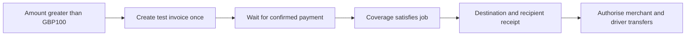

# Add, chain and attach policies

## Policy is the product

An operator can create a written rule, add typed conditions/obligations, chain it with other rules and attach the resulting policy version to a payment, job, card or counterparty. Inputs determine which gates pass. Payments execute only after every applicable mandatory gate is satisfied.

## Versioned policy bundle

A bundle contains `policyId`, immutable integer `version`, `title`, `clauses` with stable IDs/prose/typed rule nodes, `scope`, `effectiveFrom`, canonical `contentHash` and `memoryRef`. A draft is not spend authority. Activation validates the graph, stores/processes the written version in Cognee, verifies memory readiness and pins a matching validated local snapshot. Publishing takes an expected current version; stale edits return 409.

Cognee supplies the policy document, source history and evidence recall. Deterministic evaluation consumes the pinned, hash-validated executable snapshot, not arbitrary natural-language search output. Expired required memory/snapshot readiness holds financial execution. Previously confirmed payments retain the snapshot that authorised them.

## Attachments and inheritance

`PolicyAttachment = {attachmentId, targetType, targetId, policyId, policyVersion, mandatory, attachedAt}` where targetType is organisation, mission, payment, card or counterparty. Payment `policyAttachments` exposes direct attachments; `effectivePolicies` includes inherited ones.

Mandatory organisation rules always apply. Then combine all applicable mission/card/counterparty/direct-payment attachments restrictively. Child policies may tighten authority but cannot remove an inherited denial, evidence requirement or approval. Operators may detach an optional policy from a pending target; detachment is audited, version-checked and invalidates unused authorisation. Mandatory policies cannot be detached. Editing a bundle creates a new version; attached pending targets use an explicit activate/reattach operation, never an unnoticed change to an immutable version. Mandatory organisation activation re-evaluates all pending operations.

Record `effectivePolicyHash`, attachment versions, `inputRevision`, assignment version, clause path and evidence IDs on each decision. Atomic execution checks these against current state. Never rewrite historical authorisations to make them appear compliant with a later policy.

## Typed nodes

- Condition: allowlisted fact path, operator (`eq`, `gt`, `gte`, `lte`, `in`, `contains_all`) and typed value/unit.
- Evidence gate: named verifier for coverage, geofence, route corridor, receipt, funding or approval.
- Obligation: `issue_invoice`, `await_payment`, `request_approval`, `verify_coverage`, `collect_receipt`, `reserve_fuel` or an approved settlement action.
- All-of join: every incoming required gate must pass. No first-allow-wins or implicit OR.

Use an acyclic graph, maximum 32 nodes and depth 16. Validate type/units, edges, unsupported operators and action scope before activation. No executable Python/JavaScript or free-form model-generated actions. Condition false may make a conditional policy branch inapplicable; it does not waive another mandatory policy.

Outcomes are `allow`, `hold`, `deny` or `approval_required`, with matched/failed clauses, evidence and outstanding obligations. Hard denial takes precedence; missing evidence or an approval means no spend even if another branch allows. Every authorising leaf must resolve to an allowlisted operation kind and recipient.

## Example collection-to-settlement chain

Creating an invoice is a collection obligation, not proof of payment. At GBP100 use ordinary test collection; at GBP150 this example issues an invoice. Choose a single collection route per obligation so invoice collection and a standalone PaymentIntent cannot double bill. Changing policy after an obligation was already funded never charges it again. Keep `require_invoice_evidence` for an outbound supplier bill separate from `issue_invoice` to collect from a customer.

## Initial written rules

| Clause | Initial rule | Inputs |
|---|---|---|
| MONEY-1 | Positive integer GBP minor units; never exceed remaining refundable amount or reserved budget | Amount, currency, operation, ledger |
| LIMIT-1 | Transfers over GBP100 require an operation-bound human approval | Amount, recipient, versioned approval |
| INVOICE-1 | New collection obligations over GBP100 use an invoice and wait for confirmed payment | Collection amount, funding evidence |
| DRIVER-1 | Only the current approved assigned driver may receive a trip entitlement | Assignment/version, driver record |
| COVER-1 | Demo coverage must include vehicle, job type, goods value and planned route zones, valid through expected completion | Versioned coverage record and route |
| TRAVEL-1 | All route zones must be permitted by organisation policy regardless of coverage | Organisation zones, route |
| FUEL-1 | Active eligible job has at most GBP8 fuel allowance at approved fuel categories/countries | Job/coverage, merchant, country, ledger |
| FUEL-2 | Fuel stop within 100 simulated metres of approved route; location no older than 60 simulation seconds | Position, time, route geometry |
| RECEIPT-1 | Assigned driver within 100 simulated metres of destination; location <=60 simulation seconds old; recipient confirmation expires after 120 simulation seconds and is consumed once | Position, receipt nonce, assignment/order |
| PAY-1 | Merchant bill and driver fee release once only after funded and receipt gates pass | Original order, collection and delivery evidence |
| REFUND-1 | Cancel before pickup, with no recipient transfers, permits one full original-payment refund | Custody, cancellation, transfer/refund ledger |

Threshold comparison is explicit: `gt 10000 GBP` means GBP100 is not above the limit. Approval is bound to operation, amount, currency, recipient, policy/input/assignment revisions and expires on material change. Missing coverage is a hold; confirmed incompatible coverage is denial of that candidate, which GOAP may replace with an eligible candidate.

## Memory and explanation

Store written versions, graphs, activation/attachment history and structured decisions in Cognee with stable external IDs. An explanation returns the exact version, clause path, observed value, expected rule, evidence source and Stripe reference. LLM prose is optional presentation over this record; unsupported citations are rejected. A failure to recall evidence must be visible rather than filled with a plausible authorisation.

## Travel inputs are simulated

Map units are metres in a synthetic city. Locations, coverage records and receipt events are labelled simulation evidence; the server validates event identity, revision, simulated time and assignment. Rewinding a visual timeline never rewinds the ledger or sends commands. Native Issuing country/category controls do not implement a route geofence or guarantee fuel-only basket contents; application gates complement those controls.
